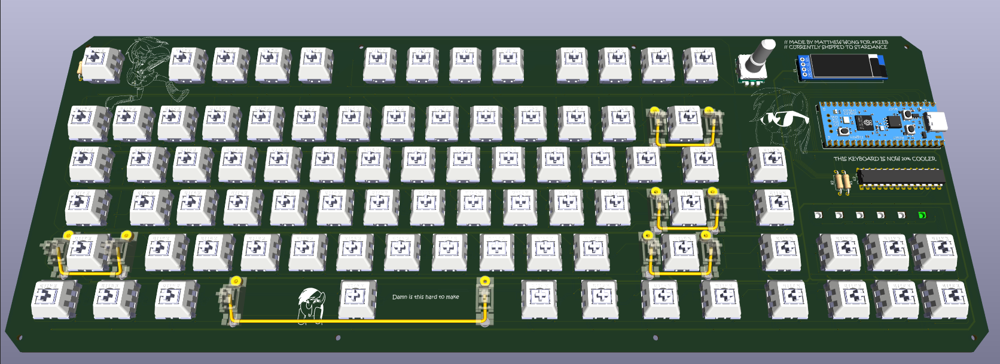
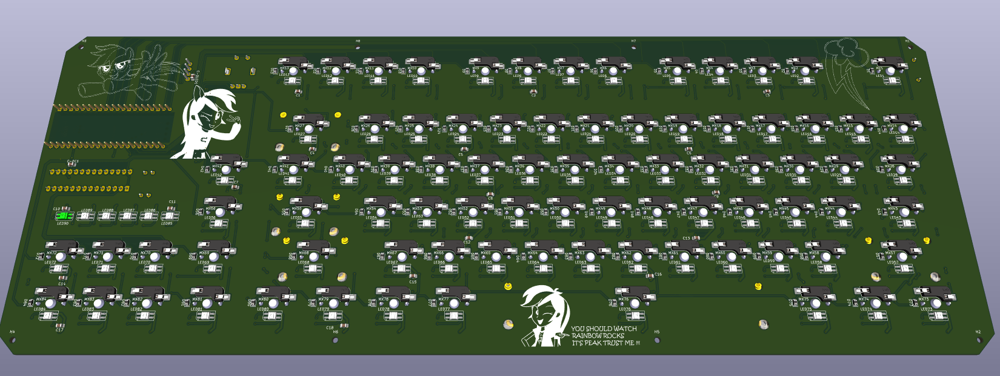
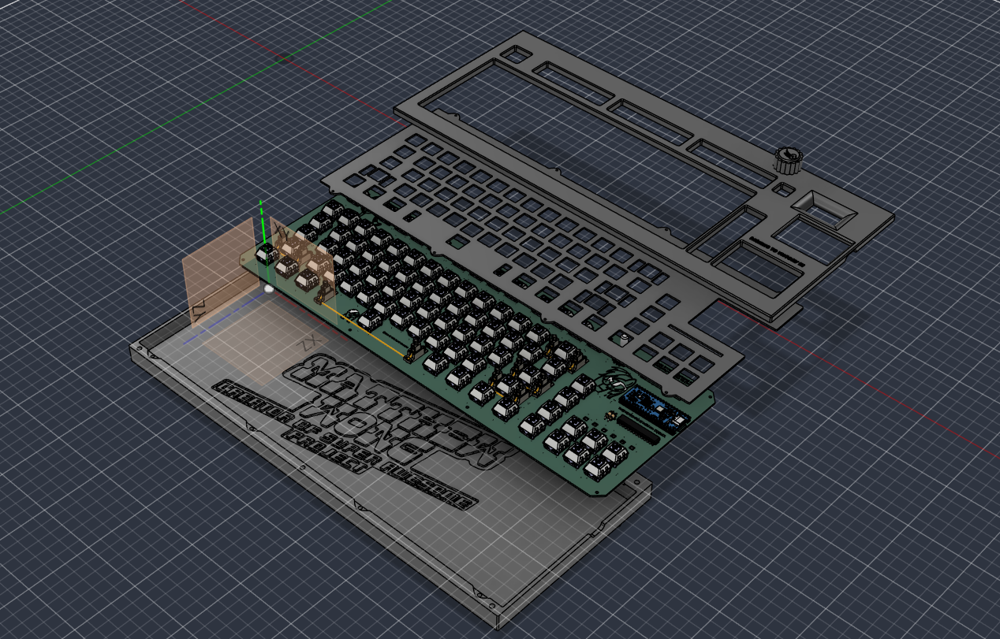
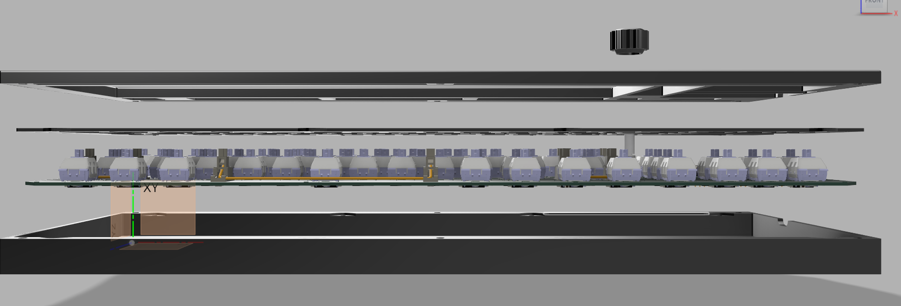
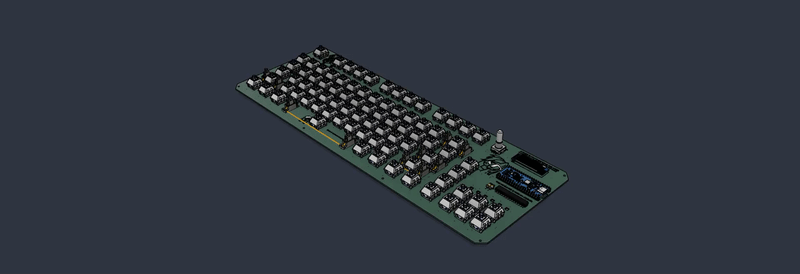

# RAINBOW-DASH-KEYBOARD-
A MLP theme KEYBOARD !!!

oh yeah , watch me take on this four day challenge to create this keyboard with no experience. (editing matthew here) so keeb got extended but i miss the deadline so im shipping to STARDANCE. oh well stardance has ended also well better luck at fabricate !!!

# The What,Why and What i learn.  
## The WHAT
RAINBOW DASH KEYBOARD is a 75% and TKL Hybrid MLP theme keyboard. this keyboard features 84 mechanical switches with hot swappable socket ,Backlit south facing RGB LED,Rotary Encoder and a 0.91 inch OLED screen.this keyboard is power by 3rd party Pico clone board with usb-c port. i also design a custom Case that uses a bottom mount system, The case will be 3d printed with FDM technology Using PETG and be painted later using spray paint. The plate will be fabricated using aluminum 6061-T6 Alloy and have an anodized blue and glass bead sanding finish.There's also a custom Knob that will be printed using PLA.

## The WHY   
so this is my first keyboard, so i decide to challenge myself to create something that's distinctly me. something that other people doesn't have and that is functional so a keyboard is fun little challenge.i want to be able look at me keyboard and be reminded of the countless night i spend making this keyboard.  

## What have i LEARN ?  
i learn lots of stuff, first of all is to do tons of research before going through something you're not familiar with. i also how to make a keyboard , how to plan your keyboard before hand so you don't mess up later in your PCB phase. (i learn all of these the hard way).
CAD is a bit harder for me because im such a perfectionist. but everything gets better with the flow of time as you gain experience. now the KEYWORD here is failing. during the whole length of this project , i fail a lot and that's how i learn ,you learn by failing and trying again.

# The PCB 

 

# The Case 

i used Bottom style mount to house my pcb , since i think it's the most balance layout between sound , cost and complexity . i also made the plate to integrate inside the bottom case so the plate would sit flush in the case. 
* Bottom Case: PLA WHITE
* TOP Case : PLA WHITE
* KEYBOARD PLATE : PLA WHITE 
* CUSTOM Knob : PLA WHITE

## the whole assembly  
STEP FILE:https://files.catbox.moe/6mzixy.step  

FUSION FILE:https://files.catbox.moe/et670v.f3z

# README
3D PRINTING : PRINTING LEGION @raahicheda4 (SG)

 

# ASSEMBLY Video

# Time   

  | no | desc | Time taken |  
  | -- | ---- | -----------|  
  | 1. | first design session | 14Hour 33Min 58 Sec |   
  | 2. | second design session | 22Hour 17Min 35Sec |  
  | 3. | CAD design session | 24Hour 27Min 46Sec |  
  | 4. | prepping model and inspection | 39Min |
  | - | total time | 62Hour 12Min 58Sec | 

# price 

| No | DESC | USD | LINK |
| -- | ---- | --- | - |
| 1. | 0805 SMD Cap (20 Piece) ELEMENT14 | 5.84$ | https://my.element14.com/kemet/c0805c104k1ractu/cap-0-1-f-100v-10-x7r-0805/dp/1650862 |
| 2. | Kalih Hot Swappable socket (110pc) | 5.84$ | https://www.aliexpress.com/item/1005007232040760.html?mp=1 |
| 3. | 330R resistor 100pc | 2.43$ | https://www.aliexpress.com/item/1005006848644172.html?mp=1 |
| 4. | 4700R resistor 100pc | 2.47$ | https://www.aliexpress.com/item/1005006848644172.html?mp=1 |
| 5. | MCP23017 DIP28 2pc | 1.78$ | https://www.aliexpress.com/item/1005008686069126.html?mp=1 | 
| 6. | EC11 Rotary Encoder 1pc | 0.69$ | https://www.aliexpress.com/item/1005007644083514.html?algo_exp_id=4c29e24d-bd95-477d-9c53-9326bed60996-0&pdp_ext_f=%7B%22order%22%3A%224254%22%2C%22spu_best_type%22%3A%22price%22%2C%22eval%22%3A%221%22%2C%22fromPage%22%3A%22search%22%7D&utparam-url=scene%3Asearch%7Cquery_from%3A%7Cx_object_id%3A1005007644083514%7C_p_origin_prod%3A#nav-specification |
| 7. | M2 Heatset Insert L 3mm 50pc  | 1.36$ | https://www.aliexpress.com/item/1005003582355741.html?mp=1 |
| 8. | M3 Heatset Insert L 3mm 50pc  | 1.42$ | https://www.aliexpress.com/item/1005003582355741.html?mp=1 | 
| 9. | HZYUEGOU M2 hex wafer head screw  5mm 50pc  | 0.90$ | https://www.aliexpress.com/item/4001072025844.html?mp=1&pdp_ext_f=%7B%22cart2PdpParams%22%3A%7B%22pdpBusinessMode%22%3A%22retail%22%7D%7D |
| 10. | HZUEGOU M3 hex Wafer head screw 20mm 25pc  |  1.07$ | https://www.aliexpress.com/item/4001072025844.html?mp=1&pdp_ext_f=%7B%22cart2PdpParams%22%3A%7B%22pdpBusinessMode%22%3A%22retail%22%7D%7D | 
| 11. | 1N4148 0805 SOD-323 diode 100pc |  0.80$ | https://www.aliexpress.com/item/1005002340232205.html?aem_p4p_detail=202609130327334855863057175440001149737&algo_exp_id=60b4e76f-acf9-47cb-b672-48cb1d45c1d7-7&pdp_ext_f=%7B%22order%22%3A%22220%22%2C%22eval%22%3A%221%22%2C%22fromPage%22%3A%22search%22%7D&utparam-url=scene%3Asearch%7Cquery_from%3A%7Cx_object_id%3A1005002340232205%7C_p_origin_prod%3A&search_p4p_id=202609130327334855863057175440001149737_2#nav-specification | 
| 12. | SK6812 MINi-E RGB reverse mount 100pc | 4.97$ | https://www.aliexpress.com/item/1005005193716172.html?mp=1 |
| 13. | Third party Pi-Pico with Usb-c 1pc | 2.67$ | - bundle deals no link |
| 14. | 0.91inch OLED SCREEN 1pc  | 2.47$ | - bundle deals no link |
| 15. | 1mm transparent acrylic sheet 1 pc | 1.02$ | - bundle deals no link | 
| 16. | Kalih Box Jade Tactile switch (90pc) | 17.38$ |
| 17. | PCB Board (5pc) | 51.02 | - | 
| 18. | Shipping Fee (ALIEXPRESS) | 1.58$ | - |
| 19. | Shipping Fee (ELEMENT14) | None | - |
| 20. | TAX (ALIEXPRESS) | 5.7$ | - | 
| 21. | Top Case,bottom case,Rainbow plate  & custom knob (Printing Legion) | 40$ | https://hackclub.slack.com/archives/C083P4FJM46/p1792146024675589 |
| 22. | shipping Fee (Printing Legion) | 10$ | https://hackclub.slack.com/archives/C083P4FJM46/p1792146024675589 |
| - | Total | 161.41$ | - |

## excluded stuff (coz it's expensive enough alr)
* spray paint & primer 
* high grit sand paper 
* solder and flux 

 

